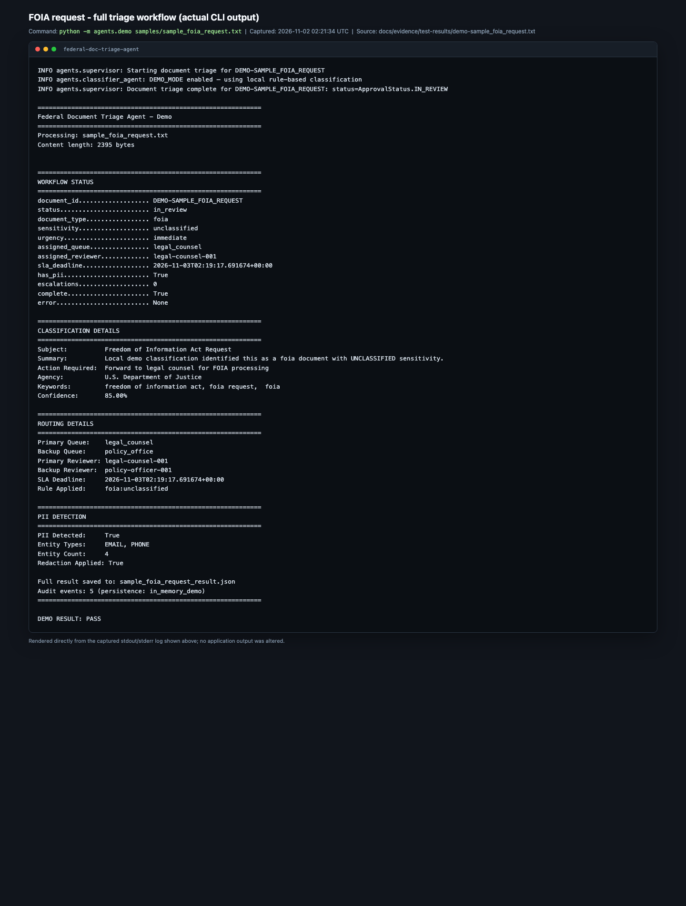
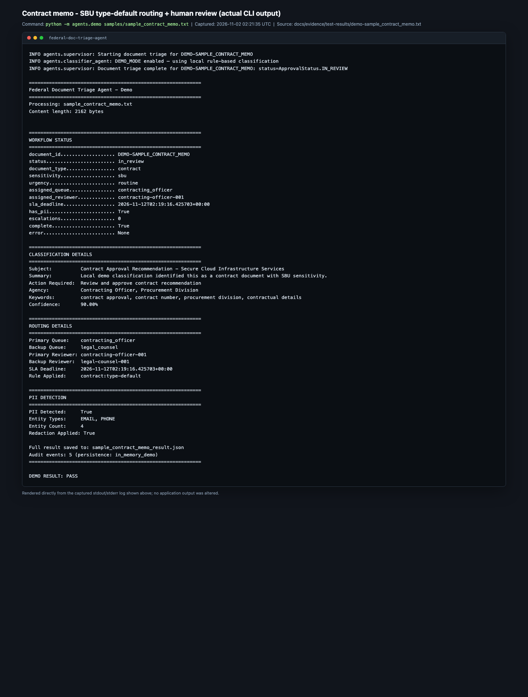
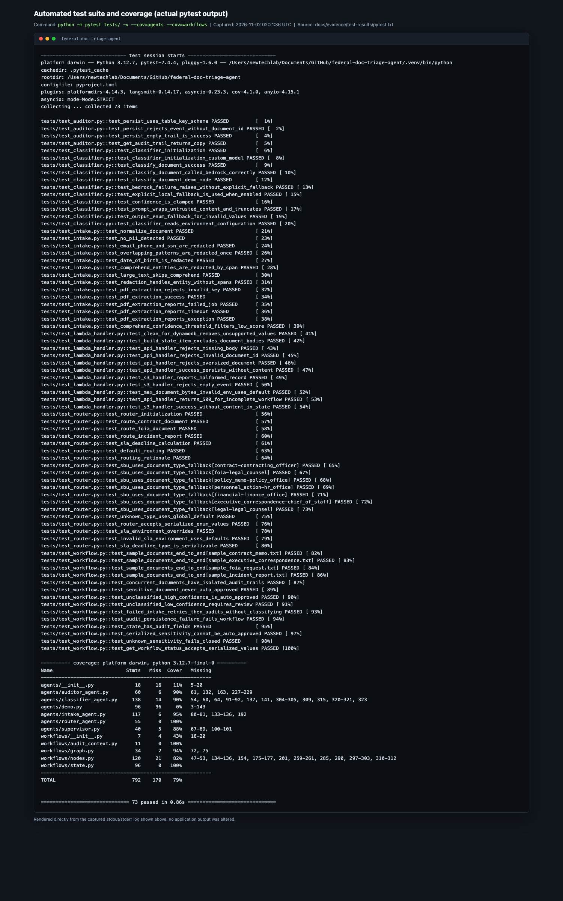
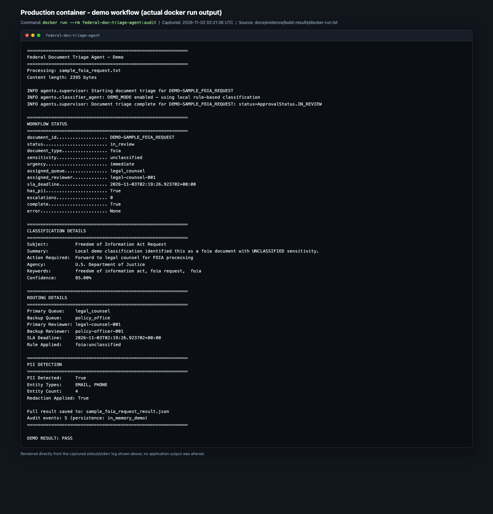
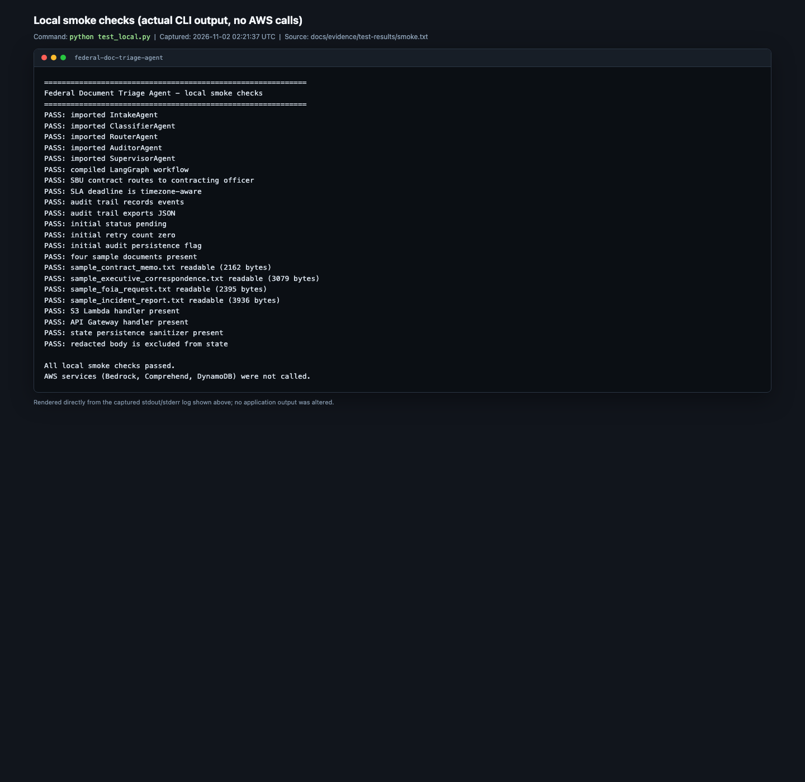
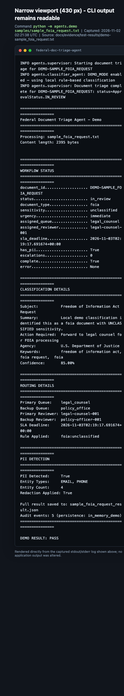

# Federal Document Triage Agent

> A tested, local-first reference implementation of an agentic document intake,
> classification, routing, and approval workflow using **LangGraph**, with
> optional **AWS Bedrock, Comprehend, Textract, DynamoDB, and S3** integrations.

[](https://www.python.org/)
[](docs/evidence/test-results/pytest.txt)
[](LICENSE)

---

## Implementation Status

This repository is a **CLI/Lambda backend**, not a web application. There is no
HTTP server or frontend to start. The verified state of the project is:

| Capability | Status | Evidence |
| --- | --- | --- |
| Local demo workflow (4 sample documents) | **Verified** | [demo logs](docs/evidence/test-results/) and [screenshots](docs/evidence/screenshots/) |
| Unit + integration suite | **Verified: 73 passed** | [pytest.txt](docs/evidence/test-results/pytest.txt) |
| Lint (`ruff`) | **Verified** | [ruff.txt](docs/evidence/test-results/ruff.txt) |
| Dependency audit (`pip-audit`) | **Verified: no known vulnerabilities** | [pip-audit.txt](docs/evidence/test-results/pip-audit.txt) |
| Docker image build / run / health check | **Verified** | [docker-build.txt](docs/evidence/build-results/docker-build.txt), [docker-healthcheck.json](docs/evidence/build-results/docker-healthcheck.json) |
| Terraform format + `validate` | **Verified** | [terraform-validate.txt](docs/evidence/build-results/terraform-validate.txt) |
| Live Bedrock / Comprehend / Textract / DynamoDB calls | **Not verified** (credentials were present, but no authorization was given for billable AWS calls or cloud changes) | — |
| `terraform apply` / GovCloud deployment | **Not performed** | — |
| Lambda provisioning | **Not implemented in Terraform**; `scripts/deploy.sh` now stops with an explicit error | [Deployment status](#aws-deployment-status) |
| Frontend / web dashboard | **Not implemented** (see [ROADMAP.md](ROADMAP.md)) | — |

Full findings, fixes, commands, and residual risks are in
[`docs/evidence/verification-report.md`](docs/evidence/verification-report.md).

---

## Overview

The agent turns a text document into a structured triage decision:

1. **Intake** — normalize text and detect/redact PII (Comprehend with a regex
   fallback).
2. **Classification** — determine document type, sensitivity, urgency, subject,
   action, agency, keywords, and confidence (Bedrock, or deterministic local
   rules in demo mode).
3. **Routing** — assign a primary/backup queue, reviewers, and an SLA deadline
   using explicit rules with a document-type fallback.
4. **Approval** — auto-approve only **unclassified** documents above the
   confidence threshold; every CUI/SBU/FOUO document goes to human review.
5. **Escalation** — flag overdue items when state is restored from a previous run.
6. **Audit** — emit an immutable-per-run audit trail and persist it to DynamoDB
   in live mode. Concurrent documents get isolated audit scopes.

The demo runner sets `DEMO_MODE=true` and `USE_COMPREHEND=false`, so it runs
without AWS credentials or network access.

---

## Architecture

```text
                    ┌─────────────────────────────┐
  sample .txt ─────▶│ IntakeAgent                 │
  S3/API (live)     │ normalize + PII redaction   │
                    └──────────────┬──────────────┘
                                   ▼
                    ┌─────────────────────────────┐
                    │ ClassifierAgent             │
                    │ Bedrock (live) / rules      │
                    └──────────────┬──────────────┘
                                   ▼
                    ┌─────────────────────────────┐
                    │ RouterAgent                 │
                    │ exact rule → type default   │
                    │ → global default; SLA       │
                    └──────────────┬──────────────┘
                                   ▼
                    ┌─────────────────────────────┐
                    │ approval_node               │
                    │ unclassified + high conf.   │
                    │ → APPROVED; else IN_REVIEW  │
                    └──────────────┬──────────────┘
                         IN_REVIEW │ else
                                   ▼
                    ┌─────────────────────────────┐
                    │ escalation_node → audit_node│
                    │ SLA check      persist/log  │
                    └─────────────────────────────┘
```

Implementation details:

- `workflows/graph.py` — LangGraph DAG. Each processing node retries up to 3
  times (4 attempts); after exhaustion the graph goes directly to audit with
  `processing_complete=False` instead of processing empty state.
- `workflows/nodes.py` — node implementations and approval policy.
- `workflows/audit_context.py` — a `ContextVar` gives every
  `SupervisorAgent.process_document()` call its own auditor, so concurrent
  documents cannot interleave or clear each other's audit trails.
- `lambda/intake_handler.py` — S3 and API Gateway handlers; state written to
  DynamoDB excludes raw and redacted document bodies.

---

## Technology Stack

| Layer | Technology |
| --- | --- |
| Language | Python 3.12 |
| Workflow orchestration | LangGraph 1.2.x, LangChain Core 1.7.x |
| Validation/types | Pydantic 2.x, `TypedDict`, Python enums |
| AWS SDK | boto3/botocore 1.43.x |
| AWS services (optional/live) | Bedrock, Comprehend, Textract, DynamoDB, S3, CloudTrail, KMS |
| Container | Python 3.12-slim, non-root `appuser` |
| Infrastructure | Terraform 1.x, AWS provider ~> 5.0 |
| Testing | pytest, pytest-asyncio, pytest-cov |
| Quality/security | ruff, pip-audit, GitHub Actions |

---

## Prerequisites

- Python **3.12+** (the verified environment is Python 3.12.7)
- `pip` and a virtual environment
- **Optional:** AWS credentials with access to Bedrock, Comprehend, Textract,
  and DynamoDB for live (non-demo) processing
- **Optional:** Docker for the container build
- **Optional:** Terraform >= 1.0 for infrastructure validation/deployment

No AWS credentials are needed for the demo, tests, lint, or Docker build.

---

## Installation

```bash
git clone https://github.com/dbsectrainer/federal-doc-triage-agent.git
cd federal-doc-triage-agent

python -m venv .venv
source .venv/bin/activate        # Windows: .venv\Scripts\activate

pip install -r requirements.txt
pip install -r requirements-dev.txt
```

There is no Python package build step; the application is run as modules from
the repository root.

---

## Environment Configuration

Copy the template and edit only what you need:

```bash
cp .env.example .env
```

The demo runner forces `DEMO_MODE=true` and `USE_COMPREHEND=false` and loads
`.env` with `python-dotenv`.

| Variable | Default | Used by | Notes |
| --- | --- | --- | --- |
| `AWS_REGION` | `us-gov-west-1` | Intake, Auditor | Region for Comprehend/Textract/DynamoDB |
| `BEDROCK_REGION` | falls back to `AWS_REGION` | Classifier | Bedrock runtime region |
| `BEDROCK_MODEL_ID` | `anthropic.claude-3-sonnet-20240229-v1:0` | Classifier | Must be available in your account/region |
| `DEMO_MODE` | `false` | Classifier, audit node | `true` uses local rules and skips DynamoDB persistence |
| `USE_COMPREHEND` | `true` | Intake | `false` uses regex PII detection only |
| `REDACTION_CONFIDENCE_THRESHOLD` | `0.8` | Intake | Filters Comprehend entities by score |
| `ALLOW_CLASSIFIER_FALLBACK` | `false` | Classifier | If true, Bedrock failure degrades to local rules; **disabled by default** so production failures are visible |
| `MAX_CLASSIFICATION_CHARS` | `60000` | Classifier | Prompt input truncation |
| `AUTO_APPROVAL_CONFIDENCE_THRESHOLD` | `0.85` | Approval | Strict `>` comparison; only unclassified docs are eligible |
| `DEFAULT_SLA_ROUTINE_DAYS` | `10` | Router | SLA override |
| `DEFAULT_SLA_PRIORITY_DAYS` | `5` | Router | SLA override |
| `DEFAULT_SLA_IMMEDIATE_HOURS` | `24` | Router | SLA override |
| `DEFAULT_SLA_EMERGENCY_HOURS` | `4` | Router | SLA override |
| `AUDIT_DYNAMODB_TABLE` / `AUDIT_TABLE_NAME` | `document-triage-audit` | Audit node | Terraform's audit table name matches |
| `STATE_DYNAMODB_TABLE` | `document-triage-state` | Lambda | Workflow-state table |
| `MAX_DOCUMENT_SIZE_MB` | `100` | Lambda API handler | Request size limit |
| `LOG_LEVEL` | `INFO` | Demo | Python logging level |

Variables present in `.env.example` but **not enforced by current code**:
`SUPPORTED_FORMATS`, `AUDIT_S3_BUCKET`, `AUDIT_RETENTION_DAYS`,
`STATE_S3_PREFIX`, `DEBUG`. Do not rely on them for behavior.

**Never commit `.env`.** It is gitignored; `.env.example` contains placeholders
only. The Docker image excludes `.env` via `.dockerignore`.

---

## Running the Application

### Local demo (no AWS credentials)

```bash
python -m agents.demo samples/sample_foia_request.txt
python -m agents.demo samples/sample_contract_memo.txt
python -m agents.demo samples/sample_incident_report.txt
python -m agents.demo samples/sample_executive_correspondence.txt
```

The demo prints workflow status, classification, routing, PII findings, and
`DEMO RESULT: PASS`. It exits non-zero on a workflow error or incomplete
processing and writes `<sample>_result.json` in the current directory.

Expected routing after the audit fixes:

| Sample | Type | Sensitivity | Queue | Approval |
| --- | --- | --- | --- | --- |
| `sample_foia_request.txt` | FOIA | unclassified | `legal_counsel` | `in_review` (confidence 0.85, not `> 0.85`) |
| `sample_contract_memo.txt` | contract | SBU | `contracting_officer` | `in_review` (sensitive) |
| `sample_incident_report.txt` | incident | CUI | `security_team` | `in_review` (sensitive) |
| `sample_executive_correspondence.txt` | executive | FOUO | `chief_of_staff` | `in_review` (sensitive) |

### Live mode

Set `DEMO_MODE=false`, configure AWS credentials/region, and call
`SupervisorAgent.process_document()` from your own entry point or deploy the
Lambda handler. Live AWS calls were **not executed in this audit**.

### There is no web server

If you are looking for a homepage, HTTP API, or browser UI: none exists in this
repository. `ROADMAP.md` describes a planned React frontend. The Lambda handlers
are the intended production entry points.

---

## Testing and Validation

```bash
# Unit + integration tests with coverage (73 tests)
python -m pytest tests/ -v --cov=agents --cov=workflows --cov-report=term-missing

# Local smoke checks without AWS
python test_local.py

# Lint
ruff check agents workflows tests lambda scripts test_local.py

# Dependency vulnerability audit
python -m pip_audit -r requirements.txt

# Terraform static checks
terraform fmt -check -recursive terraform
cd terraform && terraform init -backend=false && terraform validate
```

The test suite covers PII detection/redaction (including overlapping spans and
Textract paths), classifier parsing/fallback/prompt handling, routing (including
SBU type-default fallback), approval safety, retry/failure behavior, audit
persistence keys/failures, concurrent audit isolation, Lambda serialization and
API validation, and all four sample documents end to end.

---

## Container Build and Run

```bash
docker build -t federal-doc-triage-agent .
docker run --rm federal-doc-triage-agent
```

The image runs as non-root `appuser`, excludes `.env`/tests/docs/Terraform state,
and has a CLI-appropriate health check:

```bash
docker run -d --name triage federal-doc-triage-agent sleep 60
docker inspect --format '{{.State.Health.Status}}' triage
```

Verified health status: `healthy` (see
[`docker-healthcheck.json`](docs/evidence/build-results/docker-healthcheck.json)).

---

## AWS Deployment Status

`terraform/` provisions a **data/security baseline**: VPC with flow logs, KMS
keys, encrypted/versioned S3 intake/archive/CloudTrail buckets, DynamoDB audit
and state tables, CloudTrail, and optional GuardDuty/Security Hub. It has been
`terraform validate`d, but **`terraform apply` was not performed** in this audit
because no authorization was given to make billable AWS calls or change
cloud resources. A shared AWS credentials file was present, but it was not used.

**Important:** Terraform does **not** create the Lambda function, API Gateway,
SNS/Step Functions approval flow, or the S3 event notification. `scripts/deploy.sh`
builds a self-contained Lambda zip, but stops with an explicit error when the
function is absent. Do not treat the AWS deployment path as production-ready
until those resources are implemented and applied in a non-production account.

`scripts/deploy.sh` requires `terraform/govcloud.tfvars` (copy from
`govcloud.tfvars.example`) and a real AWS CLI session. It was not run against AWS.

---

## Screenshots

Screenshots are genuine renders of captured stdout/stderr from the commands
listed below; no application output was altered. The app is CLI-only, so the
"narrow viewport" capture demonstrates terminal readability rather than a
responsive web layout.

### FOIA workflow (desktop)



Full intake → classification → routing → approval → audit output for
`python -m agents.demo samples/sample_foia_request.txt`.

### Contract memo: SBU type-default routing and human review



Shows the fixed routing fallback (`contract:type-default` → `contracting_officer`)
and that an SBU document with 90% confidence is **not** auto-approved.

### Automated test suite



Actual `pytest -v --cov` output: all tests passing and coverage summary.

### Docker container run



Actual `docker run --rm federal-doc-triage-agent:audit` output.

### Smoke checks



Actual `python test_local.py` output; no AWS calls.

### Narrow terminal view (430 px)



The same FOIA transcript rendered at a 430 px viewport. This is not a mobile web
UI test because the application has no web UI.

---

## Project Structure

```text
federal-doc-triage-agent/
├── agents/
│   ├── __init__.py            # lazy imports
│   ├── supervisor.py          # per-run audit scope + workflow execution
│   ├── intake_agent.py        # normalization, PII detection/redaction, Textract
│   ├── classifier_agent.py    # Bedrock classification + demo rules
│   ├── router_agent.py        # exact → type-default → global routing, SLA
│   ├── auditor_agent.py       # audit events + DynamoDB persistence
│   └── demo.py                # local CLI runner
├── workflows/
│   ├── graph.py               # LangGraph DAG, retries, failure short-circuit
│   ├── nodes.py               # intake/classify/route/approval/escalation/audit
│   ├── state.py               # TypedDict schema + enums
│   └── audit_context.py       # ContextVar auditor isolation
├── lambda/intake_handler.py   # S3 + API Gateway handlers
├── tests/                     # 73 tests (classifier, router, intake, workflow,
│                              #           auditor, lambda)
├── samples/                   # 4 sample federal documents
├── terraform/                 # validated infrastructure baseline
├── scripts/
│   ├── deploy.sh              # packaging/deploy script (Lambda not provisioned)
│   └── render_evidence.py     # reproducible screenshot renderer
├── docs/
│   ├── ARCHITECTURE.md        # verified architecture + limitations
│   ├── QUICKSTART.md          # runnable quick start
│   └── evidence/              # screenshots, test/build logs, verification report
├── .github/workflows/ci.yml   # lint, tests, audit, Docker, Terraform validate
├── Dockerfile
├── .dockerignore
├── requirements.txt
├── requirements-dev.txt
├── pyproject.toml             # pytest + ruff configuration
├── LICENSE
└── README.md
```

---

## Security and Compliance

Implemented and tested locally:

- PII redaction before classification; no raw/redacted document body is written
  to the workflow-state table by the Lambda handlers.
- Sensitive documents cannot be auto-approved.
- Prompt-injection hardening: sanitized document ID, untrusted-content tags, and
  input truncation.
- Explicit classifier fallback opt-in (off by default).
- Input validation in Lambda handlers and size limits.
- Non-root container; `.env` excluded from the image.
- Dependency audit clean at the time of verification.
- Audit events keyed to the Terraform table schema; failed persistence marks the
  workflow incomplete.

**Not implemented / not verified:** live AWS IAM policies for a Lambda function,
SNS/SES reviewer notifications, Step Functions human-in-the-loop, S3 archival of
processed documents, CloudTrail query integration, FedRAMP authorization, or a
security assessment. `SECURITY.md` and `FEDRAMP-ALIGNMENT.md` are design/control
mapping documents, not evidence of authorization.

---

## Known Limitations

1. **No web UI/API server.** CLI + Lambda handlers only.
2. **AWS integrations are not exercised** in this audit; Bedrock, Comprehend,
   Textract, and DynamoDB require credentials and emulator/live validation.
3. **Terraform does not provision Lambda/API Gateway/SNS/Step Functions**, and
   `terraform apply` was not run.
4. **Escalation is a no-op within a single run.** SLA state is not persisted and
   reloaded between invocations, so overdue escalation requires a future
   scheduler/state-reload implementation.
5. **Auto-approval** is limited to unclassified documents above the threshold;
   it remains a heuristic and should be reviewed before real deployment.
6. **Reviewers are hardcoded IDs** (`legal-counsel-001`, etc.); replace with a
   staff-directory lookup before production.
7. **PDF/Textract extraction is implemented but not live-tested**; only mocked
   tests cover it.
8. **No live PII engine validation.** Regex fallback has known limitations
   (e.g., international formats, names, addresses).
9. `.env.example` contains configuration knobs that are not wired into code
   (listed above).

See [`docs/evidence/verification-report.md`](docs/evidence/verification-report.md)
for the full accounting.

---

## Documentation

- [docs/QUICKSTART.md](docs/QUICKSTART.md) — runnable setup and troubleshooting
- [docs/ARCHITECTURE.md](docs/ARCHITECTURE.md) — component and state details
- [docs/evidence/verification-report.md](docs/evidence/verification-report.md) —
  audit scope, fixes, command results, screenshots, residual risks
- [SECURITY.md](SECURITY.md) — security policy and implementation caveats
- [FEDRAMP-ALIGNMENT.md](FEDRAMP-ALIGNMENT.md) — control mapping (design)
- [ROADMAP.md](ROADMAP.md) — planned frontend work

---

## License

MIT — see [LICENSE](LICENSE).

**Author:** Donnivis Baker — BE EASY ENTERPRISES
**Document version:** 2.0 | **Verified:** 2026-11-01
